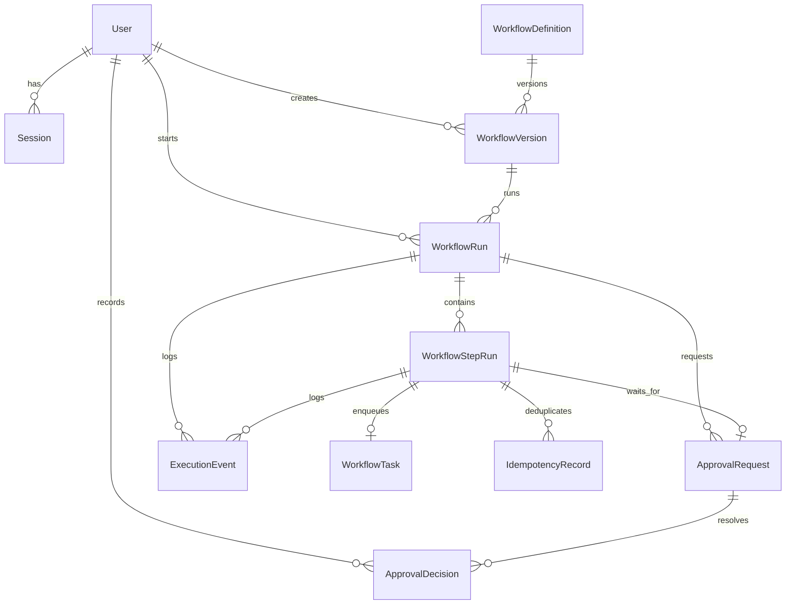

# Domain Model

## Entities

### User
- Schema/model file: [prisma/schema.prisma](../../prisma/schema.prisma) — `model User`
- Primary service owner: [src/services/auth-service.ts](../../src/services/auth-service.ts) — `loginUser()`
- Notes: Users carry the role that [src/lib/auth/permissions.ts](../../src/lib/auth/permissions.ts) maps to permissions.

### Session
- Schema/model file: [prisma/schema.prisma](../../prisma/schema.prisma) — `model Session`
- Primary service owner: [src/lib/auth/session.ts](../../src/lib/auth/session.ts) — `createSession()`, `getUserFromSessionToken()`, `destroySession()`
- Notes: Sessions are DB-backed and cookie-delivered, not JWT-only.

### WorkflowDefinition
- Schema/model file: [prisma/schema.prisma](../../prisma/schema.prisma) — `model WorkflowDefinition`
- Primary service owner: [src/services/workflow-definition-service.ts](../../src/services/workflow-definition-service.ts) — `createWorkflowDefinitionVersion()`
- Notes: This is the stable top-level identity (`key`, `name`, metadata).

### WorkflowVersion
- Schema/model file: [prisma/schema.prisma](../../prisma/schema.prisma) — `model WorkflowVersion`
- Primary service owner: [src/services/workflow-definition-service.ts](../../src/services/workflow-definition-service.ts) — `createWorkflowDefinitionVersion()`
- Notes: The actual executable workflow JSON lives in `definition` and is validated by `workflowDefinitionSchema` in [src/lib/workflows/definition-schema.ts](../../src/lib/workflows/definition-schema.ts).

### WorkflowRun
- Schema/model file: [prisma/schema.prisma](../../prisma/schema.prisma) — `model WorkflowRun`
- Primary service owner: [src/services/workflow-run-service.ts](../../src/services/workflow-run-service.ts) — `startWorkflowRun()`
- Notes: A run is pinned to one workflow version and carries mutable execution state like `status`, `context`, `currentStepKey`, and `lastError`.

### WorkflowStepRun
- Schema/model file: [prisma/schema.prisma](../../prisma/schema.prisma) — `model WorkflowStepRun`
- Primary service owner: [src/services/workflow-engine-service.ts](../../src/services/workflow-engine-service.ts) — `createTaskStep()`, `createApprovalStep()`, `createConditionStep()`
- Notes: Each logical step in the workflow definition gets one durable row with attempt counts, backoff, and status.

### WorkflowTask
- Schema/model file: [prisma/schema.prisma](../../prisma/schema.prisma) — `model WorkflowTask`
- Primary service owner: [src/services/worker-service.ts](../../src/services/worker-service.ts) — `processNextTask()`
- Notes: This is the durable worker queue item. Leasing logic lives in [src/repositories/task-repository.ts](../../src/repositories/task-repository.ts) — `claimNextAvailableTask()`.

### ApprovalRequest
- Schema/model file: [prisma/schema.prisma](../../prisma/schema.prisma) — `model ApprovalRequest`
- Primary service owner: [src/services/approval-service.ts](../../src/services/approval-service.ts) — `submitApprovalDecision()`
- Notes: Approval waits are first-class rows because they outlive worker leases and app restarts.

### ApprovalDecision
- Schema/model file: [prisma/schema.prisma](../../prisma/schema.prisma) — `model ApprovalDecision`
- Primary service owner: [src/services/workflow-engine-service.ts](../../src/services/workflow-engine-service.ts) — `resolveApprovalStep()`
- Notes: This captures the actor and comment so approval history is auditable.

### IdempotencyRecord
- Schema/model file: [prisma/schema.prisma](../../prisma/schema.prisma) — `model IdempotencyRecord`
- Primary service owner: [src/services/worker-service.ts](../../src/services/worker-service.ts) — `runIdempotentAction()`
- Notes: This stores deduped side-effect results across retries and worker restarts.

### ExecutionEvent
- Schema/model file: [prisma/schema.prisma](../../prisma/schema.prisma) — `model ExecutionEvent`
- Primary service owner: [src/services/workflow-engine-service.ts](../../src/services/workflow-engine-service.ts) — `appendExecutionEvent()` calls throughout the engine
- Notes: Mutable state lives on `WorkflowRun` and `WorkflowStepRun`; append-only history lives here.
